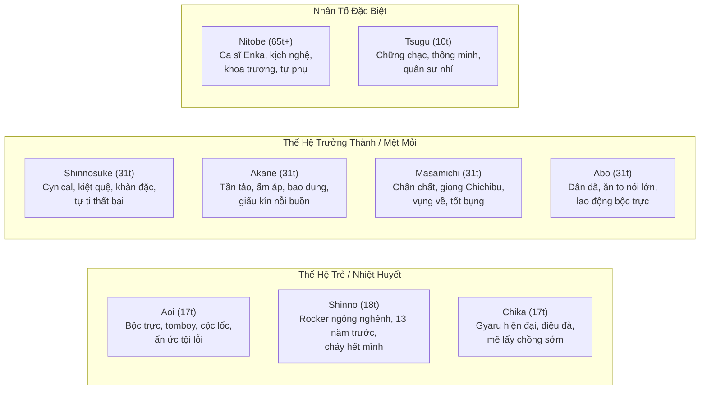

# Bộ Quy Chuẩn & Tài Liệu Bàn Giao Bản Địa Hóa Phụ Đề Tiếng Việt
### Dự Án: Sora no Aosa wo Shiru Hito yo (Her Blue Sky - 2019)
**Vị trí file Master**: `/media/cuongba956/Download/WIP - D/Sora no Aosa wo Shiru Hito yo/Her.Blue.Sky.2019.1080p.BluRay.Dual-Audio.Opus.5.1.x265-YURASUKA.ass`  
**GitHub Repo**: `https://github.com/Senki3567/Sora-no-Aosa-wo-Shiru-Hito-yo`

---

## MỤC LỤC
1. [Khung Cấu Trúc Bất Biến & Tài Nguyên Căn Bản](#1-khung-cấu-trúc-bất-biến--tài-nguyên-căn-bản)
2. [Hồ Sơ Ngôn Ngữ & Giọng Điệu Từng Nhân Vật (Persona Linguistic Profiles)](#2-hồ-sơ-ngôn-ngữ--giọng-điệu-từng-nhân-vật)
3. [Ma Trận Xưng Hô Động & Quy Luật Chuyển Đổi Trạng Thái (Dynamic Pronoun Transitions)](#3-ma-trận-xưng-hô-động--quy-luật-chuyển-đổi-trạng-thái)
4. [Quy Tắc Nhắc Đến Ngôi Thứ Ba (Third-Person References)](#4-quy-tắc-nhắc-đến-ngôi-thứ-ba)
5. [Từ Điển Thuật Ngữ Cốt Lõi & Bẫy Dịch Thuật Cần Loại Bỏ](#5-từ-điển-thuật-ngữ-cốt-lõi--bẫy-dịch-thuật-cần-loại-bỏ)
6. [Quy Chuẩn Kỹ Thuật Typeset, Ngắt Dòng libass & Kiểm Toán CPS](#6-quy-chuẩn-kỹ-thuật-typeset-ngắt-dòng-libass--kiểm-toán-cps)

---

## 1. Khung Cấu Trúc Bất Biến & Tài Nguyên Căn Bản

File master đã được thẩm định toàn diện và phân chia ranh giới vật lý bằng các thẻ comment. Quá trình dịch **chỉ được phép can thiệp vào trường `Text` của 1,471 dòng `[THOẠI]`**, tuyệt đối không dịch đè vào `[SIGN]` hoặc `[SONG]`:

```
+-----------------------------------------------------------------------------------+
|               CẤU TRÚC SỰ KIỆN TRONG FILE MASTER (.ass) - 3,045 DÒNG              |
+-----------------------------------------------------------------------------------+
| 1. [THOẠI] : 1,471 dòng (Cues 1 - 1,471)  --> PHẠM VI BIÊN TẬP DUY NHẤT          |
|    - Layer: 0 | Style: Default / Italics / Top                                    |
|    - Trường Actor: Đã chuẩn hóa 100% tên tiếng Anh (Aoi, Shinno, Akane...)       |
|    - Cấm đổi Start/End/Style/Actor. Chỉ thay thế nội dung lời thoại tiếng Việt.   |
|                                                                                   |
| 2. [SIGN]  : 1,459 dòng (Cues 1,472 - 2,930) --> KHÓA NGUYÊN VẸN 100%             |
|    - Thừa hưởng toàn bộ hệ thống Typeset 3D quang học \org, FBF của Arid/Anarchy. |
|                                                                                   |
| 3. [SONG]  : 115 dòng (Cues 2,931 - 3,045)   --> KHÓA NGUYÊN VẸN 100%             |
|    - Gồm Gandhara (prologue & tập thử) và Ending theme của Aimyon.                |
+-----------------------------------------------------------------------------------+
```

### Bộ ba tài nguyên đối soát 1:1:
1. `thoai_full_alignment.tsv`: Bảng dữ liệu đối soát trực tiếp 1,471 dòng (chứa mốc thời gian, Actor, thoại EN, thoại Nhật BD và nhãn CC).
2. `2_Ban_Dich_Viet/02_Subscene-2272610_DichChuan_FullSongLyrics_KanjiRomajiVI.ass`: Nguồn tham khảo câu chữ mượt mà nhất.
3. `3_Sub_Nhat_Goc/02_BD_Dialogue_Official_Japanese.ja.srt`: Thẩm quyền phán quyết ngữ nghĩa gốc từ kịch bản phòng thu đĩa Blu-ray.

---

## 2. Hồ Sơ Ngôn Ngữ & Giọng Điệu Từng Nhân Vật

Mỗi nhân vật trong phim đại diện cho một tầng lớp xã hội, độ tuổi và xuất thân vùng miền khác nhau tại thung lũng Chichibu (Saitama). Bản dịch Việt phải tái hiện được cá tính ngôn ngữ độc bản này:



### Chi tiết Persona Linguistic Profiles:

#### 1. Aoi Aioi (相生あおい - 17 tuổi)
- **Đại từ tiếng Nhật**: Ngôi 1 dùng `あたし` (atashi - không dùng watashi kiểu mẫu); ngôi 2 dùng `あんた` (anta), khi tức giận dùng `お前` (omae).
- **Văn phong & Nhịp điệu**: Nói cộc lốc, hay ngắt quãng, buông thõng cuối câu, dùng câu cụt. Tính cách tomboy, bất cần đời, đam mê bass điên cuồng, ôm guitar bass đi khắp nơi.
- **Tâm lý tầng sâu**: Bên ngoài xù lông nhím vì luôn tự trách mình là nguyên nhân khiến bố mẹ mất và cản trở chị Akane cùng Shinno lên Tokyo 13 năm trước.
- **Đặc trưng ngữ khí tiếng Việt**: 
  - Không dùng từ hoa mỹ, ẻo lả. Dùng từ ngữ thô ráp, trực diện ("mệt ghê", "phiền phức", "chết tiệt", "mắc mớ gì").
  - Với người lớn xa lạ: Trả lời nhát gừng, tối thiểu lịch sự nhưng toát lên vẻ chống đối ngầm.

#### 2. Shinno / Shinnosuke 18 tuổi (金室慎之介 - Linh hồn sống 13 năm trước)
- **Đại từ tiếng Nhật**: Ngôi 1 dùng `俺` (ore) phóng khoáng; ngôi 2 dùng `お前` (omae). Gọi Aoi là `あお` (Ao) hoặc `目玉スター` (Medama Star).
- **Văn phong & Nhịp điệu**: Sôi nổi, tràn trề năng lượng tuổi 18, giọng sang sảng, nói nhanh, mang phong thái một rocker vùng quê khát khao chinh phục thủ đô Tokyo.
- **Đặc trưng ngữ khí tiếng Việt**:
  - Tự tin, ngạo nghễ nhưng rất trượng nghĩa và ấm áp.
  - Xưng hô với Aoi như đàn anh bảo ban nhóc tì: "nhóc Ao", "tao - mày", sau đó khi cùng chung mục tiêu chuyển thành "anh - nhóc".

#### 3. Shinnosuke Kanamuro 31 tuổi (金室慎之介 - Hiện tại)
- **Đại từ tiếng Nhật**: Ngôi 1 dùng `俺` (ore) nặng nề mệt mỏi; khi tiếp xúc xã giao dùng `自分` (jibun); ngôi 2 dùng `あんた` / `お前`.
- **Văn phong & Nhịp điệu**: Giọng trầm khàn vì khói thuốc lá, nhịp nói chậm chạp, hay thở dài chán chường, buông lời mỉa mai, cay đắng về thực tế cuộc đời (`プロなめんなよ` - "Đừng có coi thường giới chuyên nghiệp").
- **Đặc trưng ngữ khí tiếng Việt**:
  - Ngôn từ mang vẻ bất cần, phong trần của người đàn ông ngoài 30 vấp ngã ê chề ở Tokyo.
  - Ban đầu đối xử với Aoi như một đứa con nít phiền phức ("ông chú này - nhóc con"), nhưng khi ngọn lửa trong lòng được thắp lại ở cao trào thì khẩu khí trở nên quyết liệt, đanh thép.

#### 4. Akane Aioi (相生あかね - 31 tuổi)
- **Đại từ tiếng Nhật**: Ngôi 1 dùng `私` (watashi); ngôi 2 dùng `あなた` hoặc gọi thẳng tên.
- **Văn phong & Nhịp điệu**: Nhẹ nhàng, chậm rãi, chuẩn mực của một công chức Tòa thị chính và người chị gái bao dung thay mẹ nuôi nấng em từ bé.
- **Đặc trưng ngữ khí tiếng Việt**:
  - Dịu dàng, đôn hậu, xưng "chị - em" với Aoi đầy yêu thương.
  - Khi nói chuyện với Masamichi: Thoải mái trêu đùa như bạn chí cốt cùng lớp cấp 3 ("Michinko", "ông tướng").
  - Khi đối diện Shinnosuke: Giữ khoảng cách lịch thiệp bên ngoài nhưng ánh lên sự bối rối, ngập ngừng của tình đầu dang dở.

#### 5. Masamichi Nakamura / Michinko (中村正道 - 31 tuổi)
- **Đại từ tiếng Nhật**: Ngôi 1 dùng `俺` (ore); ngôi 2 dùng `お前` / `あかね`.
- **Chất địa phương (Chichibu-ben)**: Dùng các đuôi từ địa phương vùng núi Saitama/Chichibu (`〜だんべ`, `〜べえ`, `おっちゃん`).
- **Văn phong & Nhịp điệu**: Chân chất, bộc trực, ăn to nói lớn, nhiệt tình đến mức ngố tàu. Luôn hết mình vì địa phương và thầm yêu Akane suốt 13 năm.
- **Đặc trưng ngữ khí tiếng Việt**:
  - Mang hơi hướm phương ngữ mộc mạc, gần gũi kiểu thanh niên thôn quê miền đồng bằng/trung du ("ấy mà", "chứ lị", "đúng không nè", "ông tướng").

#### 6. Masatsugu Nakamura / Tsugu (中村正嗣 - 10-11 tuổi)
- **Đại từ tiếng Nhật**: Ngôi 1 dùng `僕` (boku); xưng hô với Masamichi là `父ちゃん` (bố).
- **Văn phong & Nhịp điệu**: Điềm tĩnh, chín chắn, nói chuyện gãy gọn, thông minh vượt tuổi tác, chuyên đóng vai "quân sư tình cảm" giục bố tỏ tình với Akane.
- **Đặc trưng ngữ khí tiếng Việt**: Lễ phép, đáng yêu, gọi Aoi là "chị Ao", gọi bố là "bố" hoặc trêu là "bố Michinko".

#### 7. Dankichi Nitobe (新渡戸団吉 - 65+ tuổi)
- **Đại từ tiếng Nhật**: Ngôi 1 dùng `わし` (washi) hoặc xưng tên ngôi ba `団吉` (Dankichi); ngôi 2 dùng `あんた達` / `若いの`.
- **Văn phong & Nhịp điệu**: Trịch thượng, kịch nghệ (theatrical), khoa trương, hay hoa chân múa tay làm dáng, dùng từ Hán tự cổ điển và biệt ngữ giới biểu diễn Enka.
- **Đặc trưng ngữ khí tiếng Việt**: Dùng ngôi xưng "Ta - các cô cậu", "lão già này", giọng điệu hào sảng, cường điệu hóa mọi sự việc nhưng bản chất không hề ác ý.

#### 8. Chika Ohtaki (大滝千佳 - 17 tuổi)
- **Văn phong & Nhịp điệu**: Điển hình nữ sinh Gyaru năng động, nói rất nhanh, cảm thán liên tục (`キャー`, `ヤバい`, `ウケる`), cuồng nhiệt với ý nghĩ tìm bạn trai và lấy chồng để thoát khỏi thung lũng Chichibu tù túng.
- **Đặc trưng ngữ khí tiếng Việt**: Nhí nhảnh, nhiều từ đệm cảm thán ("trời ơi", "xỉu á", "mê xỉu", "mày coi kìa"), xưng "tao - mày" tự nhiên với Aoi.

#### 9. Abo (阿保 - 31 tuổi)
- **Văn phong & Nhịp điệu**: Bạn cùng ban nhạc cấp 3, hiện làm công nhân bảo trì đường bộ. Giọng ăn to nói lớn, xuề xòa, thân mật kiểu anh em chiến hữu lâu ngày gặp lại.
- **Đặc trưng ngữ khí tiếng Việt**: "Mày - tao", "thằng quỷ", "ông nội", giọng điệu khỏe khoắn của người lao động chân tay.

---

## 3. Ma Trận Xưng Hô Động & Quy Luật Chuyển Đổi Trạng Thái

Xưng hô trong phim **không tĩnh tại** mà biến đổi sâu sắc theo 4 giai đoạn mạch truyện và các bùng nổ cảm xúc:

```
[Timeline Phim]
Phase 1: Quá Khứ & Sự Xuất Hiện Bí Ẩn (00:00 - 00:22)
    └── Ngạc nhiên, sợ hãi, phòng thủ, khoảng cách thế hệ.
Phase 2: Tái Ngộ & Xung Đột Nội Tâm (00:22 - 01:10)
    └── Bàn nhậu gượng gạo, Aoi đối đầu Shinnosuke lớn, thấu hiểu Shinno nhỏ.
Phase 3: Bão Lũ, Sạt Lở & Bước Ngoặt Tình Cảm (01:10 - 01:31)
    └── Vứt bỏ sĩ diện, tình thế ngàn cân treo sợi tóc, vội vã, lo âu tột cùng.
Phase 4: Bay Lên Bầu Trời & Hạ Màn Tỉnh Thức (01:31 - Kết)
    └── Bùng nổ cảm xúc, xóa bỏ đại từ xa cách, lời tỏ tình chân thật.
```

### Bảng Ma Trận Động Toàn Diện:

| Cặp Nhân Vật | Giai Đoạn / Tình Huống | Đại Từ Bên A Gọi B | Đại Từ Bên B Gọi A | Bản Chất Quan Hệ & Ghi Chú Ngữ Cảnh |
|:---|:---|:---:|:---:|:---|
| **Aoi <-> Akane** | *Thường ngày* | **Em** (`あたし`) - **Chị** (`あか姉`) | **Chị** (`私`) - **Ao / Em** | Gọi thân mật `あか姉` -> dịch là **"chị Akane"** hoặc **"chị"**. |
| | *Khi cãi vã / Tự ái (00:14)* | **Tôi - Chị** | **Chị - Em** | Aoi gắt gỏng khi Akane giục thi cử, xưng "tôi" để đẩy chị ra xa. |
| | *Khóc nghẹn ngào (Cuối phim)* | **Em - Chị** | **Chị - Ao** | Tình cảm ruột thịt vỡ òa, Aoi nhận ra sự hy sinh thầm lặng của chị. |
| **Shinno <-> Aoi** | *Ban đầu (00:20 - 00:23)* | **Nhóc / Tao** - **Cậu / Quỷ** | **Tôi / Ma** - **Cậu / Anh** | Aoi tưởng Shinno là ma (`幽霊`), sợ hãi; Shinno bực mình vì bị gọi là ma. |
| | *Thân thiết & Tập đàn (00:30)* | **Anh / Tao** (`俺`) - **Nhóc Ao** (`あお`) | **Tôi / Nhóc** - **Anh / Shinno** | Cùng chơi nhạc, Shinno gọi Aoi là `目玉スター` ("Ngôi sao Mắt Tròn"). |
| | *Cao trào bay trên trời (01:32)* | **Anh - Em / Ao** | **Em - Anh / Shinno** | Aoi tuyên bố ủng hộ tình yêu của Shinno: *"Em sẽ ủng hộ anh và anh Shinnosuke!"* |
| **Shinnosuke (31t) <-> Aoi** | *Gặp lại (00:25 - 00:37)* | **Tôi** (`俺`) - **Nhóc** (`ガキ`) | **Tôi** - **Ông chú / Anh** (`慎之介さん`) | Shinnosuke coi thường Aoi là đồ con nít; Aoi cay đắng vì thần tượng sụp đổ. |
| | *Đối chất đền Phật (01:23)* | **Tôi - Cô bé / Nhóc** | **Tôi - Anh Shinnosuke** | Aoi chất vấn tại sao anh lại bỏ mặc chị Akane. |
| | *Sáng hôm sau (01:40)* | **Anh - Nhóc Ao** | **Em - Anh** | Shinnosuke dịu giọng, cảm kích vì Aoi đã kéo anh ra khỏi vũng lầy. |
| **Shinno <-> Shinnosuke** | *Đối đầu trực diện (01:23)* | **Tao** (`俺`) - **Mày / Lão già** | **Tao** (`俺`) - **Thằng ranh** | Xung đột giữa cái tôi 18 tuổi ngây thơ và bản thể 31 tuổi kiệt quệ: *"Tao không thèm hiểu thứ ông già nhếch nhác như mày!"* |
| | *Hóa giải lúc tiếp sức (01:38)* | **Tôi - Anh** (hoặc **Tao - Mày**) | **Tao - Cậu** | Shinnosuke thừa nhận Shinno chính là phần dũng cảm nhất mà mình từng đánh mất. |
| **Shinno <-> Akane** | *Hồi ức 13 năm trước* | **Anh / Tôi** (`俺`) - **Em** (`あかね`) | **Em** (`私`) - **Anh Shinno** | Tình yêu tuổi học trò trong trẻo, bẽn lẽn. |
| | *Hội ngộ trong không trung (01:34)* | **Anh** (`俺`) - **Em** (`あかね`) | **Em** (`私`) - **Shinno** | Xóa nhòa 13 năm khoảng cách: *"Biển rộng thế nào anh không biết, nhưng anh biết bầu trời xanh bao la!"* |
| **Shinnosuke (31t) <-> Akane** | *Gặp lại ở quán nhậu (00:25)* | **Tôi - Cô / Akane** | **Tôi - Anh / Shinnosuke-kun** | Gượng gạo, ngập ngừng, giữ phép lịch sự trước mặt Nitobe và đồng nghiệp. |
| | *Tỏ tình trên đồi (01:39)* | **Anh** (`俺`) - **Em** (`あかね`) | **Em** (`私`) - **Anh** | Shinnosuke lấy lại tự tin: *"Anh sẽ không bỏ cuộc đâu... Và anh cũng không từ bỏ em đâu!"* |
| **Masamichi <-> Akane** | *Thường nhật* | **Tôi / Tớ** (`俺`) - **Bà / Cậu** | **Bà / Tớ** - **Ông / Michinko** (`みちんこ`) | Bạn học chí cốt; Masamichi luôn xun xoe, Akane thường bắt bài trêu chọc. |
| | *Nghiêm túc (00:13, 00:25)* | **Tôi - Akane-san / Bà** | **Tôi - Masamichi / Michinko** | Masamichi cố tỏ ra chín chắn khi bàn công việc Tòa thị chính. |
| **Tsugu <-> Masamichi** | *Xuyên suốt* | **Con** (`僕`) - **Bố / Bố Michinko** (`父ちゃん`) | **Bố** (`俺`) - **Con / Tsugu** | Con trai thông minh hơn bố; Tsugu hay giục: *"Bố mau đi tỏ tình đi!"* |
| **Tsugu <-> Aoi** | *Xuyên suốt* | **Em** (`僕`) - **Chị Ao** (`あおちゃん`) | **Chị** (`あたし`) - **Tsugu** | Tsugu bám Aoi, Aoi coi Tsugu như em trai nhỏ. |
| **Chika <-> Aoi** | *Xuyên suốt* | **Tao / Mày** (`あんた`) - **Mày / Tao** | **Tao / Mày** - **Mày / Tao** | Bạn thân cùng bàn, nói chuyện bỗ bã, không câu nệ khách khí. |
| **Nitobe <-> Cả nhóm** | *Xuyên suốt* | **Ta / Lão già này** (`わし`) - **Các cô cậu** | **Chúng tôi** - **Thầy / Bác Nitobe** | Nitobe giữ uy thế nghệ sĩ tiền bối, nói năng đao to búa lớn. |

---

## 4. Quy Tắc Nhắc Đến Ngôi Thứ Ba (Third-Person References)

Khi các nhân vật trò chuyện và nhắc đến một người vắng mặt, việc dịch đại từ ngôi thứ ba phản ánh chính xác lập trường tình cảm:

1. **Khi nhắc về Akane (`あかね`)**:
   - Aoi nói với bất kỳ ai (kể cả Shinno, thầy cô, bạn bè): Luôn gọi là **"chị Akane"** hoặc **"chị gái em"** (あか姉). Tuyệt đối không dịch thành "nó" hay "cô ấy".
   - Shinno (18t) nói với Aoi: Luôn nói là **"Akane"** (coi Akane là người yêu bình đẳng, không bao giờ gọi là "chị gái mày").
   - Shinnosuke (31t) nói với đồng nghiệp: Dùng **"cô Akane"** / **"Akane-san"**; khi nói với Masamichi dùng **"Akane"**.
   - Masamichi nói với con trai (Tsugu) hoặc người ngoài: Gọi là **"cô Akane"** (`あかねちゃん`).
2. **Khi nhắc về Shinno (18t) vs Shinnosuke (31t)**:
   - Aoi nói về hồn ma 18 tuổi: Gọi là **"Shinno"** (しんの - chữ Hiragana).
   - Aoi nói về người lớn 31 tuổi: Gọi là **"anh Shinnosuke"** (慎之介さん - chữ Kanji).
   - Cần phân định rõ nét hai danh xưng này trong thoại tiếng Việt để khán giả không bị nhầm lẫn giữa hai bản thể tồn tại song song.
3. **Khi nhắc về Masamichi (`中村正道`)**:
   - Akane, Shinno, Abo và bạn bè: Luôn gọi trêu bằng biệt danh **"Michinko"** (`みちんこ`).
   - Aoi và Tsugu: Gọi là **"chú Michinko"** hoặc **"bố Michinko"**.
   - Cấp dưới và người ngoài thị trấn: Gọi là **"anh Nakamura"** hoặc **"cán bộ Nakamura"**.

---

## 5. Từ Điển Thuật Ngữ Cốt Lõi & Bẫy Dịch Thuật Cần Loại Bỏ

```
+----------------------------------------------------------------------------------------------------+
|                                    GLOSSARY & MISTRANSLATION AUDIT                                 |
+--------------------------+------------------------------+------------------------------------------+
| Thuật Ngữ Tiếng Nhật     | Bản Dịch Sai / Thô Cần Tránh | Bản Dịch Chuẩn Xưởng Khuyên Dùng         |
+--------------------------+------------------------------+------------------------------------------+
| 1. ツナマヨ (Tuna mayo)  | "Cá hồi" (Lỗi nặng Olshiro!) | Cá ngừ sốt mayo / Cơm nắm cá ngừ mayo    |
|    昆布 (Kombu)          | "Rong biển khô"              | Tảo bẹ / Cơm nắm tảo bẹ                  |
+--------------------------+------------------------------+------------------------------------------+
| 2. 井の中の蛙大海を知らず| "Coi trời bằng vung"         | "Ếch ngồi đáy giếng tuy chẳng hay biển   |
|    されど空の青さを知る  | (Phá hủy triết lý bộ phim!)  | rộng, nhưng thấu rõ trời xanh."          |
+--------------------------+------------------------------+------------------------------------------+
| 3. 目玉スター            | "Ngôi sao mắt lồi"           | Ngôi sao Mắt Tròn / Mắt Biếc Ngôi Sao    |
|    (Medama Suta)         | "Mắt ếch tinh tú"            | (Biệt danh cưng Shinno đặt cho bé Aoi)   |
+--------------------------+------------------------------+------------------------------------------+
| 4. あかねスペシャル      | "Món đặc biệt của Akane"     | Akane Special                            |
|    (Akane Supesharu)     | (Nhầm thành món ăn!)         | (Tên cây đàn guitar quý của Shinnosuke)  |
+--------------------------+------------------------------+------------------------------------------+
| 5. ガンダーラ            | "Gandara" / "Xứ thần tiên"   | Gandhara (Giữ nguyên tên bài hát kinh    |
|    (Gandhara)            |                              | điển của ban nhạc Godiego năm 1978)      |
+--------------------------+------------------------------+------------------------------------------+
| 6. 生き霊 (Ikiryo) /     | "Hồn ma" / "Con ma"          | Linh hồn sống / Phân thân linh hồn       |
|    生霊 (Shikin)         | (Shinno không phải ma chết)  | (Tâm niệm thanh xuân bị mắc kẹt lại)     |
+--------------------------+------------------------------+------------------------------------------+
| 7. 堂 (Doji-do)          | "Ngôi đền" / "Miếu hoang"    | Điện Phật Doji / Gian thờ Doji           |
|                          |                              | (Nơi ban nhạc tập 13 năm trước)          |
+--------------------------+------------------------------+------------------------------------------+
| 8. 秩父 (Chichibu)       | "Chi-chi-bu"                 | Chichibu (Thị trấn thung lũng ở Saitama) |
+--------------------------+------------------------------+------------------------------------------+
| 9. 凱旋公演 (Gaisen)     | "Buổi hòa nhạc vinh quang"   | Buổi biểu diễn khải hoàn về quê hương    |
+--------------------------+------------------------------+------------------------------------------+
```

---

## 6. Quy Chuẩn Kỹ Thuật Typeset, Ngắt Dòng libass & Kiểm Toán CPS

1. **Quy Tắc Độ Dài & Ngắt Hàng Bằng Thẻ `\N`**:
   - Chiều dài an toàn hiển thị của style `Default` (font cỡ 48 trên PlayRes 1920x1080): **Tối đa 38 - 42 ký tự tiếng Việt trên một dòng**.
   - Khi câu vượt quá 42 ký tự, bắt buộc phải ngắt thành 2 hàng bằng thẻ `\N`.
   - **Quy tắc ngữ pháp khi bẻ dòng**:
     - *Được ngắt*: Sau dấu phẩy, sau liên từ ("và", "nhưng", "bởi vì", "cho nên"), trước cụm giới từ.
     - *Tuyệt đối cấm ngắt*: Tách rời tên riêng (ví dụ: `Shinnosuke` để `Shin-` hàng trên `nosuke` hàng dưới); tách rời từ ghép (ví dụ: `cơm \N nắm`, `bầu \N trời`); để lại một từ đơn lẻ côi cút (orphan word) ở dòng thứ hai.
2. **Quy Chuẩn Tốc Độ Đọc (CPS - Characters Per Second)**:
   - Tốc độ đọc chuẩn cho phim anime tâm lý: **12 - 16 CPS**.
   - Đoạn hội thoại nhanh/tranh cãi gay gắt: Chấp nhận tối đa **20 CPS**. Nếu vượt quá 22 CPS, người biên tập phải cô đọng câu chữ, lược bỏ các hư từ không mang nghĩa để đảm bảo mắt khán giả kịp quét hết text.
3. **Bảo Tồn Override Tags Trong Thoại Gốc**:
   - Một số cue thoại EN có chứa các thẻ in nghiêng `{\i1}...{\i0}` hoặc thẻ làm mờ chữ `{\alpha&FF}` (ví dụ: Line 1238-1240 Aoi ngập ngừng gọi tên, hoặc Line 1450 Shinno tan biến dần). **Phải giữ nguyên vẹn 100% các thẻ override đặc biệt này trong câu dịch tiếng Việt**.
4. **Cổng Kiểm Toán Tự Động Trước Khi Giao Bản Dịch**:
   - Chạy `python3 ass_tools.py lint-tags <file_output.ass>`: Xác nhận 0 lỗi cú pháp override tags.
   - Chạy `python3 ass_tools.py timing-qc <file_output.ass>`: Rà soát phát hiện các điểm nghẽn CPS đỏ.
   - Kiểm tra hiển thị font dấu tiếng Việt: Đảm bảo không bị vỡ glyph hoặc biến dạng ký tự (`ơ`, `ư`, `ắ`, `ặ`, `ẽ`, `ỹ`).
