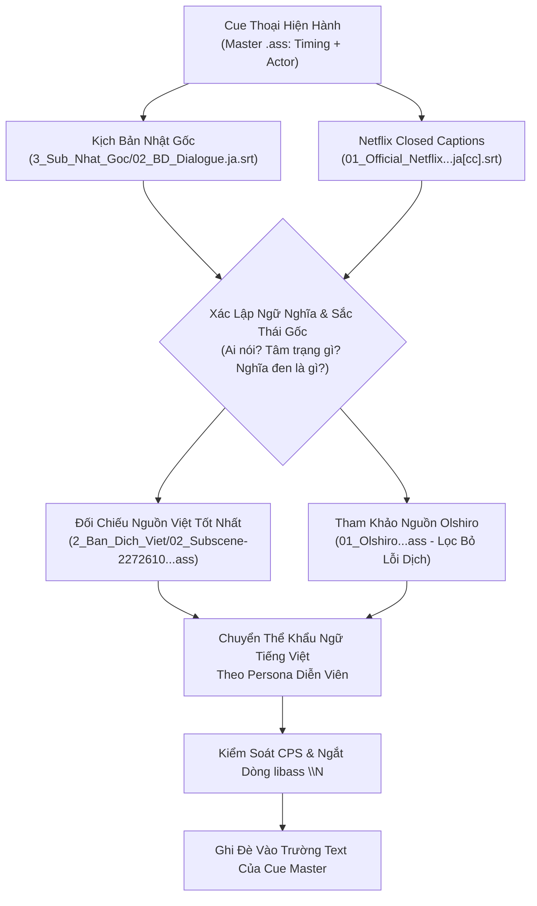

# Bộ Quy Chuẩn & Cẩm Nang Bản Địa Hóa Phụ Đề Tiếng Việt Chuẩn Xưởng
### Dự Án: Sora no Aosa wo Shiru Hito yo (Her Blue Sky - 2019)
**File Master Baseline**: `/media/cuongba956/Download/WIP - D/Sora no Aosa wo Shiru Hito yo/Her.Blue.Sky.2019.1080p.BluRay.Dual-Audio.Opus.5.1.x265-YURASUKA.ass`  
**GitHub Repository**: `https://github.com/Senki3567/Sora-no-Aosa-wo-Shiru-Hito-yo`  
**Bảng Đối Soát 1:1**: `thoai_full_alignment.tsv`

---

## MỤC LỤC
1. [Triết Lý Cốt Lõi: Bản Địa Hóa Khẩu Ngữ Sống Động (Spoken vs. Written Language)](#1-triết-lý-cốt-lõi-bản-địa-hóa-khẩu-ngữ-sống-động)
2. [Giao Thức Khai Thác Đa Nguồn (Multi-Source Synergy Protocol)](#2-giao-thức-khai-thác-đa-nguồn)
3. [Công Thái Học Phụ Đề, Kiểm Toán CPS & Kỹ Thuật Ngắt Dòng `\N`](#3-công-thái-học-phụ-đề-kiểm-toán-cps--kỹ-thuật-ngắt-dòng-n)
4. [Hồ Sơ Ngôn Ngữ & Cá Tính Từng Nhân Vật (Persona Linguistic Profiles)](#4-hồ-sơ-ngôn-ngữ--cá-tính-từng-nhân-vật)
5. [Ma Trận Xưng Hô Động & Chuyển Biến Cảm Xúc Theo Mạch Truyện](#5-ma-trận-xưng-hô-động--chuyển-biến-cảm-xúc-theo-mạch-truyện)
6. [Quy Tắc Nhắc Đến Ngôi Thứ Ba (Third-Person References)](#6-quy-tắc-nhắc-đến-ngôi-thứ-ba)
7. [Từ Điển Thuật Ngữ Cốt Lõi & Bẫy Dịch Thuật Tuyệt Đối Tránh](#7-từ-điển-thuật-ngữ-cốt-lõi--bẫy-dịch-thuật-tuyệt-đối-tránh)
8. [Cổng Kiểm Định Kỹ Thuật Tự Động Trước Khi Nghiệm Thu](#8-cổng-kiểm-định-kỹ-thuật-tự-động-trước-khi-nghiệm-thu)

---

## 1. Triết Lý Cốt Lõi: Bản Địa Hóa Khẩu Ngữ Sống Động

> [!IMPORTANT]
> **Phụ đề là VĂN NÓI để nghe bằng mắt trong 1.5 - 3 giây, hoàn toàn KHÔNG PHẢI VĂN VIẾT để đọc nghiền ngẫm như trang sách.**  
> Khán giả tiếp nhận phụ đề song song với biểu cảm hình ảnh và ngữ điệu lồng tiếng của diễn viên. Một bản dịch chuẩn xưởng phải tạo ra cảm giác nhân vật đang thực sự nói tiếng Việt từ chính khuôn miệng và tâm can của họ.

### 4 Nguyên tắc chuyển dịch từ Văn Viết sang Khẩu Ngữ:

1. **Lược bỏ đại từ và chủ ngữ thừa thãi**:
   - Tiếng Nhật là ngôn ngữ ẩn chủ ngữ cao độ. Tiếng Việt giao tiếp đời thường cũng tương tự.
   - *Văn viết thô*: *"Tôi nghĩ rằng hôm nay chúng ta nên đi đến trường học cùng nhau."*
   - *Khẩu ngữ anime*: *"Hôm nay đi học chung nha."*
2. **Khai thác hệ thống trợ từ ngữ khí tiếng Việt**:
   - Chêm các từ đệm cảm xúc mang hơi thở đời sống: `hả`, `sao`, `đấy`, `nhỉ`, `nè`, `chứ`, `cơ mà`, `đâu có`, `mà lại`, `cơ chứ`.
   - Giúp câu thoại bắt khớp hoàn hảo với các đuôi câu tiếng Nhật như `〜ね`, `〜よ`, `〜か`, `〜わ`, `〜の`, `〜じゃん`.
3. **Tuyệt đối tránh các khuôn mẫu "dịch máy / sách giáo khoa"**:
   - Cấm dịch rập khuôn:
     - `本当に` -> Đừng lúc nào cũng "Thật sự là...". Hãy thay bằng: "Thiệt luôn á?", "Bộ tính làm vậy thật hả?", "Nói nghiêm túc đấy à?".
     - `どうして` -> Đừng lúc nào cũng "Tại sao...". Hãy thay bằng: "Sao vậy?", "Làm sao thế?", "Mắc gì chứ?".
     - `嘘つき` -> Đừng dịch cứng nhắc "Đồ dối trá". Hãy dịch: "Đồ điêu!", "Xạo ke!", "Nói dối!".
     - `まさか` -> Thay vì "Chẳng lẽ...", hãy dùng: "Không lẽ...", "Đừng nói là...", "Lẽ nào...".
4. **Nhịp điệu câu khớp với thời lượng cue thoại**:
   - Cue ngắn (< 1.2s): Câu chữ phải sắc lẹm, dứt khoát, dùng từ đơn tiết.
   - Cue dài / độc thoại tự sự: Dùng nhịp điệu êm đềm, từ ngữ giàu sức gợi hình và chất thơ.

### Bảng Đối Chiếu Thực Tế Giữa Văn Viết Thô & Khẩu Ngữ Anime:

| Ngữ Cảnh Trong Phim | Tiếng Nhật Gốc (BD) | Tiếng Anh (Master) | Bản Dịch Văn Viết Cũ (Cần Tránh) | Khẩu Ngữ Chuẩn Xưởng Khuyên Dùng |
|:---|:---|:---|:---|:---|
| **Aoi bực tức ở phòng tập** (`00:05:05`) | うるさい デブ！ あかねを取るな！ | Shut up, you pig! Don't take Akane away! | *"Câm miệng đi, đồ lợn béo! Đừng có cướp đi Akane của tao!"* | **"Im đi đồ heo mập! Trả chị Akane lại đây mau!"** |
| **Aoi nói về định hướng** (`00:07:00`) | バイトしながらバンドで天下取ります | I'll work part-time while rising to fame in a band. | *"Tôi sẽ vừa làm việc bán thời gian vừa đoạt lấy thiên hạ bằng ban nhạc."* | **"Em vừa làm thêm vừa chơi ban nhạc, rồi sẽ làm trùm thiên hạ luôn!"** |
| **Shinno trách cơm nắm** (`00:01:48`) | 何回言ったら分かんだよ、ツナマヨがいいって！ | I've said it a million times, I want mayonnaise and tuna! | *"Anh đã nói bao nhiêu lần rồi hả, anh muốn cá hồi cơ mà!"* (Sai cả nghĩa) | **"Phải nói bao nhiêu lần chị mới hiểu hả, em muốn ăn cá ngừ mayo cơ mà!"** |
| **Masamichi trêu Shinnosuke** (`00:25:00`) | なあ、しんの | Right, Shinno? | *"Đúng không vậy hả Shinnosuke?"* | **"Chuẩn chưa, Shinno?"** *(kèm tiếng vỗ lưng)* |
| **Shinnosuke nhếch mép** (`00:36:58`) | こっちはプロでやってんすから | I'm a professional. | *"Bên này chúng tôi đang làm việc chuyên nghiệp."* | **"Tụi này chơi chuyên nghiệp kiếm cơm đấy nhé."** |

---

## 2. Giao Thức Khai Thác Đa Nguồn

Dự án sở hữu kho tài nguyên đa ngữ đồ sộ. Mỗi nguồn giữ một vai trò độc nhất vô nhị. Người biên tập phải vận hành quy trình phối hợp nguồn chặt chẽ:



### Bảng Phân Tích & Cách Khai Thác Từng Nguồn Cụ Thể:

| Thư mục & Tên File | Thế Mạnh & Giá Trị Sử Dụng | Nhược Điểm / Rủi Ro Cần Lưu Ý | Cách Thức Phối Hợp Trong Quy Trình |
|:---|:---|:---|:---|
| **Master Baseline**<br>`Her.Blue.Sky...YURASUKA.ass` | Khung chuẩn 1:1, timecode chuẩn khớp video BD, đã audit sạch sẽ trường `Actor`, bảo tồn 1,459 dòng Typeset 3D và 115 dòng bài hát. | Không chứa lời thoại tiếng Việt. | **File đích duy nhất để ghi đè lời dịch.** Khóa cứng trường timecode và Actor. |
| **Bảng Tra Cứu**<br>`thoai_full_alignment.tsv` | Bảng tra cứu Excel/TSV gồm 1,471 dòng đối soát song song EN - BD - CC - Actor. | Không mở trực tiếp trong Aegisub được. | Dùng tra cứu nhanh khi dịch trên script hoặc trình soạn thảo code. |
| **Tiếng Nhật Gốc**<br>`3_Sub_Nhat_Goc/02_BD_Dialogue...ja.srt` | **Thẩm quyền tối cao về mặt ngữ nghĩa.** Lời thoại chuẩn xác từ phòng thu diễn viên lồng tiếng. | Không có nhãn tên nhân vật ở từng dòng. | Đối chiếu khi thấy tiếng Anh dịch thoát nghĩa, tối nghĩa hoặc bản dịch Việt cũ dịch ngô nghê. |
| **Closed Captions Nhật**<br>`3_Sub_Nhat_Goc/01_Official_Netflix...ja[cc].srt` | Chứa 923 nhãn speaker, âm thanh nền (tiếng thở, tiếng khóc, tiếng vỗ tay, tiếng đàn). | Nhiều câu thoại bị gộp chung vào 1 cue thời gian dài. | Đối chiếu để xác định chính xác người ngắt lời, tiếng thở dài, tiếng thì thầm. |
| **Bản Việt Subscene**<br>`2_Ban_Dich_Viet/02_Subscene-2272610...ass` | **Bản dịch tiếng Việt xuất sắc nhất hiện có.** Lời thoại mượt mà, đúng "cá ngừ" và "tảo bẹ", trọn vẹn 3 dòng Kanji/Romaji/Việt cho bài hát. | Thiếu Typeset sign, timecode bị lệch nhẹ so với bản BD Arid. | **Nguồn nguyên liệu văn phong chính.** Lấy câu chữ từ đây để căn vào cue của Master. |
| **Bản Việt Olshiro**<br>`2_Ban_Dich_Viet/01_Olshiro...ass` | Nhiều bạn trẻ quen thuộc, cách xưng hô suồng sã kiểu fan anime khá tốt. | Dính lỗi dịch nghiêm trọng: tuna thành "cá hồi", tựa phim thành "coi trời bằng vung", sót tag `{...}` tiếng Anh. | Tham khảo các đoạn chửi thề, lóng tuổi teen; **bắt buộc loại bỏ toàn bộ lỗi dịch sai**. |
| **Song Ngữ Nekomoe**<br>`3_Sub_Nhat_Goc/03_Nekomoe_kissaten...ass` | Bản Trung - Nhật song song từng dòng. | Dùng font chữ Hán. | Cực kỳ hữu dụng khi cần giải nghĩa các câu thành ngữ 4 chữ (Yojijukugo) hoặc tiếng lóng Chichibu. |

---

## 3. Công Thái Học Phụ Đề, Kiểm Toán CPS & Kỹ Thuật Ngắt Dòng `\N`

### 1. Giới hạn Tốc độ đọc (CPS - Characters Per Second):
$$CPS = \frac{\text{Tổng số ký tự (bao gồm cả dấu cách)}}{\text{Thời lượng hiển thị (giây)}}$$

- **Vùng Xanh (Lý tưởng)**: **10 - 15 CPS**. Đảm bảo mắt người đọc kịp lướt mà vẫn thưởng thức trọn vẹn diễn hoạt khung hình.
- **Vùng Vàng (Chấp nhận được)**: **16 - 19 CPS**. Dành cho các phân đoạn nhân vật nói liên tục, cãi cọ gay gắt hoặc đọc rap/hát nhanh.
- **Vùng Đỏ (Báo động - Cần gọt giũa)**: **$\ge 20$ CPS**. Bắt buộc người biên tập phải cô đọng ngữ nghĩa, cắt tỉa các từ dư thừa, tăng tốc độ truyền tải thông tin.

### 2. Kỹ thuật ngắt dòng bằng thẻ `\N`:
Phần mềm `libass` hiển thị phụ đề theo pixel. Nếu không ngắt dòng chủ động bằng `\N`, phụ đề sẽ tự động tràn bờ (wrap) tại vị trí ngẫu nhiên, gây mất cân đối thị giác nghiêm trọng:

```
[QUY TẮC BẺ DÒNG THỊ GIÁC]
❌ Xấu (Tràn tự động / Hình nón ngược):
Tôi không thể nào quên được những ngày tháng tươi đẹp mà chúng ta đã từng trải qua
cùng nhau

✔️ Đẹp (Hình thang thuận / Cân đối ngữ nghĩa):
Tôi không thể nào quên những ngày tháng tươi đẹp\Nmà chúng ta từng trải qua cùng nhau.
```

- **Quy tắc độ dài an toàn**: Font thoại cỡ 48 trên PlayRes `1920x1080` chỉ chứa tối đa **38 - 42 ký tự tiếng Việt** trên một hàng. Dài hơn 42 ký tự bắt buộc phải dùng `\N`.
- **Tuyệt đối cấm**:
  - Không để lại một từ đơn lẻ (orphan word) ở dòng thứ 2 (Ví dụ: `...đã từng trải qua\Ncùng`).
  - Không bẻ đôi từ ghép tiếng Việt (Ví dụ: `cơm\Nnắm`, `bầu\Ntrời`, `sạt\Nlở`).
  - Không bẻ rời tên riêng hoặc liên danh (Ví dụ: `Shinnosuke\Nkun`, `chị\NAkane`).
- **Vị trí vàng để đặt `\N`**:
  - Ngay sau dấu phẩy (`,`), dấu chấm phẩy (`;`), dấu chấm lửng (`...`).
  - Trước liên từ phụ thuộc: `và`, `nhưng`, `bởi vì`, `cho nên`, `thế nhưng`, `để rồi`.
  - Giữa hai vế của cấu trúc sóng đôi (hô ứng).

---

## 4. Hồ Sơ Ngôn Ngữ & Cá Tính Từng Nhân Vật

Mỗi nhân vật mang một chất giọng độc bản (vùng miền, lứa tuổi, vết thương tâm lý). Bản dịch Việt phải làm nổi bật được các nét cá tính này:

### 1. Aoi Aioi (相生あおい - 17 tuổi)
- **Đại từ Nhật**: Ngôi 1 dùng `あたし` (atashi); ngôi 2 dùng `あんた` (anta) / `お前` (omae).
- **Văn phong**: Tomboy, ngang tàng, bất cần, bộc trực, ăn nói cộc lốc, hay buông câu cụt. Mặc cảm tội lỗi vì nghĩ mình cản trở chị gái. Ôm cây bass như vật bất ly thân.
- **Từ ngữ đặc trưng**: Dùng từ lóng gai góc của nữ sinh quậy: "mệt ghê", "chết tiệt", "phiền phức", "rồi sao", "mắc mớ gì".

### 2. Shinno (金室慎之介 - 18 tuổi, linh hồn sống 13 năm trước)
- **Đại từ Nhật**: Ngôi 1 dùng `俺` (ore) sang sảng; ngôi 2 dùng `お前` (omae). Gọi Aoi là `あお` (Ao) hoặc `目玉スター` (Medama Star).
- **Văn phong**: Rocker vùng quê ngông nghênh, phóng khoáng, hừng hực lửa thanh xuân, mơ ước chinh phục Tokyo. Rất trượng nghĩa, nhiệt thành, không bao giờ vòng vo.
- **Từ ngữ đặc trưng**: "Nhóc Ao", "nhóc con", "bộ tính...", "cháy hết mình đi chứ", "ngon lành".

### 3. Shinnosuke Kanamuro (金室慎之介 - 31 tuổi, hiện tại)
- **Đại từ Nhật**: Ngôi 1 dùng `俺` (ore); xã giao dùng `自分` (jibun); ngôi 2 dùng `あんた` / `お前` / `ガキ`.
- **Văn phong**: Giọng khàn đặc thuốc lá, mệt mỏi, chán chường, buông lời mỉa mai, tự ti vì ước mơ tan vỡ chỉ làm kẻ đánh đàn thuê cho ca sĩ Enka.
- **Từ ngữ đặc trưng**: "Đừng có coi thường dân chuyên", "ông già này", "nhóc con", "bỏ đi", "chả có ích gì đâu".

### 4. Akane Aioi (相生あかね - 31 tuổi)
- **Đại từ Nhật**: Ngôi 1 dùng `私` (watashi); ngôi 2 dùng `あなた` hoặc tên riêng.
- **Văn phong**: Dịu dàng, đôn hậu, bao dung, vừa làm chị vừa làm mẹ. Giấu kín nỗi buồn và tình yêu dang dở vào sâu trong đáy mắt.
- **Từ ngữ đặc trưng**: Nói năng nhỏ nhẹ, ấm áp với Aoi; thoải mái, tinh nghịch khi gọi Masamichi là "Michinko".

### 5. Masamichi Nakamura / Michinko (中村正道 - 31 tuổi)
- **Phương ngữ Chichibu (Saitama-ben)**: Hay đệm đuôi từ địa phương `〜だんべ`, `〜べえ`, `おっちゃん`.
- **Văn phong**: Chân chất, bộc trực, ngố tàu, tốt bụng, xốc vác. Thầm thương Akane suốt 13 năm nhưng nhát gan không dám mở lời.
- **Từ ngữ đặc trưng tiếng Việt**: Hơi hướm nông dân/thôn quê trung du chất phác: "ấy mà", "chứ lị", "đúng không nè", "ông tướng", "chết thật".

### 6. Tsugu (中村正嗣 - 10-11 tuổi)
- **Văn phong**: Cậu bé thông minh vượt tuổi, điềm tĩnh, chững chạc, làm "quân sư quạt mo" cho bố Masamichi.
- **Từ ngữ đặc trưng**: Lễ phép, xưng "em" với Aoi ("chị Ao"), gọi bố là "bố" hoặc trêu chọc "bố Michinko".

### 7. Dankichi Nitobe (新渡戸団吉 - 65+ tuổi)
- **Văn phong**: Ca sĩ Enka tiền bối, kịch nghệ, phóng đại, thích tạo dáng, tự xưng `わし` (Ta/Lão già này) hoặc gọi tên mình `団吉` ở ngôi thứ ba.
- **Từ ngữ đặc trưng**: Dùng từ Hán Việt cổ kính, khoa trương, đao to búa lớn nhưng nhân hậu: "Ta", "các cô cậu", "chuyến khải hoàn", "tuyệt tác".

### 8. Chika Ohtaki (大滝千佳 - 17 tuổi)
- **Văn phong**: Nữ sinh Gyaru nhí nhảnh, nói như súng liên thanh, cuồng lấy chồng để rời Chichibu.
- **Từ ngữ đặc trưng**: "Trời đất ơi", "mê xỉu", "xỉu up xỉu down", "tao", "mày".

### 9. Abo (阿保 - 31 tuổi)
- **Văn phong**: Dân lao động bảo trì đường bộ, bạn ban nhạc cũ, ăn to nói lớn, khỏe khoắn, xuề xòa.
- **Từ ngữ đặc trưng**: "Mày - tao", "thằng quỷ", "ông nội", "làm gì vội thế".

---

## 5. Ma Trận Xưng Hô Động & Chuyển Biến Cảm Xúc Theo Mạch Truyện

Xưng hô biến chuyển sâu sắc theo 4 hồi kịch tính của bộ phim:

| Cặp Nhân Vật | Giai Đoạn 1: Hoài Nghi & Khép Kín (00:00 - 00:22) | Giai Đoạn 2: Xung Đột & Thấu Hiểu (00:22 - 01:10) | Giai Đoạn 3: Sạt Lở & Nguy Cấp (01:10 - 01:31) | Giai Đoạn 4: Bay Lên Bầu Trời & Tỏ Tình (01:31 - Hết) |
|:---|:---|:---|:---|:---|
| **Aoi <-> Akane** | **Em - Chị** *(nghịch ngợm)*<br>hoặc **Tôi - Chị** *(khi tự ái)* | **Em - Chị** *(bắt đầu hiểu gánh nặng của chị)* | **Em - Chị Akane** *(hoảng loạn tìm kiếm)* | **Em - Chị** *(vỡ òa xúc động, biết ơn khôn xiết)* |
| **Shinno <-> Aoi** | **Ma - Người** *(Aoi sợ hãi)*<br>**Tao - Con nhóc** | **Tao - Nhóc Ao**<br>**Anh - Nhóc** *(cùng tập đàn)* | **Tao - Nhóc** *(Shinno ghen tị bản thể lớn)* | **Anh - Em**<br>Aoi: *"Em sẽ ủng hộ anh và anh Shinnosuke!"* |
| **Shinnosuke (31t) <-> Aoi** | *(Chưa xuất hiện)* | **Tôi - Nhóc con**<br>**Tôi - Ông chú** *(đối đầu khinh rẻ)* | **Tôi - Nhóc** *(chất vấn ở điện thờ)* | **Anh - Em**<br>Shinnosuke: *"Cảm ơn nhóc nhiều nhé, Ao."* |
| **Shinno <-> Shinnosuke** | *(Chưa gặp)* | *(Chưa gặp)* | **Tao - Mày** *(Shinno: "Tao không thèm hiểu ông già nhếch nhác như mày!")* | **Tôi - Anh** / **Tao - Mày** *(thấu hiểu, chấp nhận và tiếp sức)* |
| **Shinno <-> Akane** | **Anh - Em** *(kỷ niệm 13 năm trước)* | *(Chưa gặp lại)* | *(Shinno bồn chồn muốn phá rào)* | **Anh - Em** *(Shinno ôm Akane bay giữa trời, xóa tan 13 năm nuối tiếc)* |
| **Shinnosuke <-> Akane** | *(Chưa gặp)* | **Tôi - Anh / Cô** *(ngập ngừng, khách khí ở quán nhậu)* | **Anh - Em** *(chạy bộ trong bão tìm người yêu)* | **Anh - Em**<br>Shinnosuke: *"Anh sẽ không bỏ cuộc đâu... Và anh cũng không từ bỏ em đâu!"* |
| **Masamichi <-> Akane** | **Tớ - Cậu** / **Michinko - Akane** | **Tôi - Bà** *(bàn việc công vụ, Masamichi ghen ngầm)* | **Tôi - Akane** *(lo lắng thông báo sạt lở)* | **Tôi - Bà** *(ấm ức nhưng chúc phúc cho bạn)* |
| **Tsugu <-> Masamichi** | **Bố - Con** *(Tsugu trêu chọc)* | **Bố - Con** *(Tsugu giục tỏ tình)* | **Bố - Con** *(lo lắng cho Akane)* | **Bố - Con** *(Tsugu an ủi Masamichi)* |

---

## 6. Quy Tắc Nhắc Đến Ngôi Thứ Ba (Third-Person References)

Khi nhân vật trò chuyện và nhắc đến người vắng mặt:
1. **Nhắc về Akane (`あかね`)**:
   - Aoi nói với mọi người: Luôn là **"chị Akane"** (`あか姉`).
   - Shinno (18t) nói với Aoi: Luôn gọi thẳng **"Akane"** (tư thế người yêu bình đẳng).
   - Shinnosuke (31t) nói xã giao: Dùng **"cô Akane"** / **"Akane-san"**; nói với Masamichi: Dùng **"Akane"**.
2. **Nhắc về Shinno (18t) vs Shinnosuke (31t)**:
   - Aoi nói về hồn sống 18 tuổi: Gọi là **"Shinno"** (しんの - Hiragana).
   - Aoi nói về người lớn 31 tuổi: Gọi là **"anh Shinnosuke"** (慎之介さん - Kanji).
   - Bắt buộc phân định rạch ròi hai danh xưng để người xem không bị rối trí.

---

## 7. Từ Điển Thuật Ngữ Cốt Lõi & Bẫy Dịch Thuật Tuyệt Đối Tránh

| Thuật ngữ Nhật gốc | Bản dịch sai/thô (CẤM DÙNG) | Bản dịch chuẩn xưởng khuyên dùng | Lý do ngữ cảnh cốt lõi |
|:---|:---|:---|:---|
| **ツナマヨ** (Tuna mayo) | "Cá hồi" | **Cá ngừ sốt mayo** / **Cơm nắm cá ngừ** | Món Shinno luôn đòi ăn. Tương phản với món tảo bẹ Aoi thích. |
| **昆布** (Kombu) | "Rong biển khô" | **Tảo bẹ** / **Cơm nắm nhân tảo bẹ** | Akane luôn làm nhân này vì Aoi thích ăn, dù Shinno đòi cá ngừ. |
| **井の中の蛙大海を知らず、されど空の青さを知る** | "Coi trời bằng vung" | **"Ếch ngồi đáy giếng tuy chẳng hay biển rộng, nhưng thấu rõ trời xanh."** | Tựa đề và linh hồn bộ phim. Dù ở lại quê nhà, Akane vẫn tìm thấy hạnh phúc sâu thẳm. |
| **目玉スター** (Medama Star) | "Ngôi sao mắt lồi" | **Ngôi sao Mắt Tròn** / **Mắt Biếc Ngôi Sao** | Biệt danh âu yếm Shinno đặt cho bé Aoi vì mắt to tròn xoe. |
| **あかねスペシャル** | "Món đặc biệt của Akane" | **Akane Special** | Tên cây đàn guitar bass/lead của Shinno dành tiền mua. |
| **ガンダーラ** (Gandhara) | "Xứ thần tiên" | **Gandhara** | Tên bài hát kinh điển năm 1978 của ban nhạc Godiego. |
| **生き霊** (Ikiryo) / 生霊 | "Con ma", "Xác sống" | **Linh hồn sống** / **Phân thân linh hồn** | Shinno là chấp niệm thanh xuân bị mắc kẹt, không phải hồn ma người chết. |
| **堂** (Doji-do) | "Miếu hoang" | **Điện Phật Doji** / **Gian thờ Doji** | Nơi ban nhạc tập luyện 13 năm trước và nơi Shinno bị giam cầm. |
| **秩父** (Chichibu) | "Chi-chi-bu" | **Chichibu** | Thị trấn thung lũng có thật ở tỉnh Saitama. |

---

## 8. Cổng Kiểm Định Kỹ Thuật Tự Động Trước Khi Nghiệm Thu

Sau khi hoàn tất việc dịch 1,471 dòng `[THOẠI]`, bắt buộc phải chạy qua 3 cổng kiểm toán kỹ thuật từ skill `ass-studio`:

1. **Kiểm tra cú pháp thẻ (Tag Lint)**:
   ```bash
   python3 /home/cuongba956/.gemini/config/skills/ass-studio/scripts/ass_tools.py lint-tags "<file_output.ass>"
   ```
   *Yêu cầu*: `events_with_issues_count: 0`, không sót ngoặc nhọn `{`, không lỗi lồng thẻ `\t`.
2. **Kiểm tra tốc độ đọc (Timing & CPS QC)**:
   ```bash
   python3 /home/cuongba956/.gemini/config/skills/ass-studio/scripts/ass_tools.py timing-qc "<file_output.ass>"
   ```
   *Yêu cầu*: Rà soát toàn bộ các cue vượt ngưỡng 20 CPS để gọt câu cô đọng.
3. **Kiểm tra độ phủ Glyph tiếng Việt (Font Audit)**:
   - Đảm bảo font thoại hiển thị hoàn hảo các ký tự tiếng Việt đặc thù (`ơ`, `ư`, `ắ`, `ặ`, `ẽ`, `ỹ`), không xuất hiện ô vuông (tofu) hay bị fallback về font hệ thống xấu xí.
