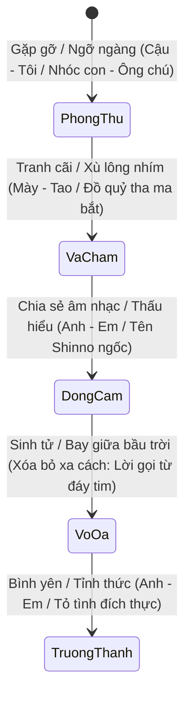

# Cẩm Nang Biên Kịch & Bản Địa Hóa Phụ Đề: "Sora no Aosa wo Shiru Hito yo"
### Bản Sắc Nhân Vật, Khẩu Ngữ Điện Ảnh & Quy Chuẩn Thoại Chuẩn Xưởng
**File Master Baseline**: `/media/cuongba956/Download/WIP - D/Sora no Aosa wo Shiru Hito yo/Her.Blue.Sky.2019.1080p.BluRay.Dual-Audio.Opus.5.1.x265-YURASUKA.ass`  
**GitHub Repository**: `https://github.com/Senki3567/Sora-no-Aosa-wo-Shiru-Hito-yo`  
**Bảng Đối Soát 1:1**: `thoai_full_alignment.tsv`

---

## 1. Bản Sắc Điện Ảnh Của Phim & Bút Pháp Mari Okada

> [!CAUTION]
> **TUYỆT ĐỐI KHÔNG BIẾN THOẠI PHIM THÀNH VĂN BẢN VÔ HỒN HAY "AI SLOP"**  
> *"Sora no Aosa wo Shiru Hito yo"* là tác phẩm đỉnh cao của biên kịch Mari Okada (bộ ba Chichibu: *AnoHana*, *Kokosake*, *SoraAosa*). Đặc trưng bất hủ của bà là: **nhân vật luôn nói những lời vụng về, dối lòng để che giấu những vết thương sâu kín nhất.**  
> Nếu áp dụng các bảng công thức cứng nhắc, dịch từ đối từ theo kiểu máy móc, phụ đề sẽ trở nên trơ tráo, sáo rỗng và giết chết toàn bộ chiều sâu cảm xúc của bộ phim.

### 3 Chân Lý Cốt Tử Về Lời Thoại Điện Ảnh:
1. **Lời nói dối & Khoảng lặng (Subtext > Text)**:
   - Nhân vật trong phim hiếm khi nói thẳng điều họ nghĩ. 
   - Khi Aoi hét: *"Im đi đồ heo mập!"* hay *"Phiền phức chết đi được!"*, thực chất trong lòng cô bé là sự tự căm ghét bản thân vì nghĩ mình là gánh nặng giam cầm chị gái.
   - Khi Shinnosuke 31 tuổi buông lời cay nghiệt: *"Tao không rảnh chơi đồ hàng với con nít"*, đó không phải sự kiêu ngạo của một kẻ chuyên nghiệp, mà là sự nhục nhã, cay đắng tột cùng của một kẻ thất bại ở Tokyo, không dám đối diện với cây đàn và ước mơ thuở thiếu thời.
2. **Khẩu ngữ Chichibu: Mộc mạc, bình dân, ngột ngạt nhưng ấm áp**:
   - Chichibu là thung lũng lòng chảo bị bao bọc bởi núi cao. Con người ở đây chân chất, thật thà, có chút thô kệch của dân lao động miền núi.
   - Tuyệt đối không dùng tiếng lóng mạng xã hội thành thị thời thượng (tránh xa: *u là trời, ét o ét, flex, thao túng tâm lý, cà khịa*). Phải dùng thứ tiếng Việt đời thường, gần gũi, ăn chắc mặc bền, có hơi hướm phương ngữ trung du bình dị.
3. **Thoại là để diễn viên nói và khán giả nghe bằng mắt**:
   - Mỗi câu thoại phải được "đọc to thành tiếng" trong đầu người dịch. Nếu câu thoại đọc lên nghe trúc trắc, gượng gạo, văn vẻ như tiểu thuyết dịch hay sách giáo khoa, **đó là bản dịch hỏng**.

---

## 2. Bản Sắc Giọng Nói Của Từng Con Người (Character Personas)

Không có "nhãn nhân vật chung chung". Mỗi con người trong phim có một nỗi niềm riêng, tạo nên khẩu khí riêng biệt:

```
+---------------------------------------------------------------------------------------------------+
|                                  BẢN SẮC NGỮ ÂM CỦA CÁC NHÂN VẬT                                  |
+-------------------+---------------------------------------+---------------------------------------+
| Nhân vật          | Nỗi Niềm Ẩn Giấu & Tâm Lý             | Khẩu Khí & Chất Giọng Tiếng Việt      |
+-------------------+---------------------------------------+---------------------------------------+
| **Aoi** (17t)     | Cảm giác tội lỗi vì bố mẹ mất và chị  | Cộc lốc, gai góc, buông câu cụt, nhát |
| (Bass player)     | Akane phải từ bỏ Tokyo để nuôi mình;  | gừng. Luôn xù lông nhím phòng thủ để  |
|                   | tự tạo vỏ bọc bất cần để chị đỡ lo.   | giấu đi giọt nước mắt chực trào.      |
+-------------------+---------------------------------------+---------------------------------------+
| **Shinno** (18t)  | Chấp niệm thanh xuân 13 năm trước bị  | Sang sảng, hừng hực lửa rock & roll,  |
| (Hồn sống)        | giam cầm; yêu Akane tha thiết, muốn   | ngông nghênh nhưng cực kỳ trong sáng, |
|                   | đưa Akane thoát khỏi thị trấn này.    | ấm áp, thẳng thắn, không chút toan tính.|
+-------------------+---------------------------------------+---------------------------------------+
| **Shinnosuke**    | Giấc mơ Tokyo tan vỡ; 31 tuổi chỉ đi  | Khàn đặc khói thuốc, mệt mỏi, chán    |
| (31 tuổi)         | đánh đàn thuê cho ca sĩ Enka; tự ti,  | đời, hay cười khẩy chua chát, bất cần |
| (Hiện tại)        | xấu hổ không dám nhìn thẳng mặt Akane.| nhưng lòng đau như cắt khi Akane gặp nạn.|
+-------------------+---------------------------------------+---------------------------------------+
| **Akane** (31t)   | Người chị kiêm người mẹ 13 năm tảo tần| Dịu dàng, đôn hậu, giọng nói ấm áp bao|
| (Chị gái)         | nuôi em; hy sinh tuổi xuân không một  | dung. Giấu kín nỗi cô đơn và nuối tiếc|
|                   | lời than vãn; chôn chặt tình đầu.     | vào nụ cười hiền hậu, hay trêu bạn bè.|
+-------------------+---------------------------------------+---------------------------------------+
| **Masamichi**     | Công chức Tòa thị chính; thầm yêu     | Chân chất, bộc trực, ăn to nói lớn,   |
| (Michinko - 31t)  | Akane suốt 13 năm; vụng về, tốt bụng, | mang giọng điệu nông dân Chichibu     |
|                   | xốc vác nhưng hễ tỏ tình là run rẩy.  | mộc mạc ("ấy mà", "chứ lị", "ông tướng").|
+-------------------+---------------------------------------+---------------------------------------+
| **Tsugu** (10t)   | Cậu bé mồ côi mẹ (bố mẹ ly hôn); sống | Thông minh, lém lỉnh, chín chắn trước |
| (Con Masamichi)   | với bố ngố; quan sát nhạy bén, đóng   | tuổi. Lễ phép, đáng yêu, nói câu nào  |
|                   | vai "quân sư tình trường" cho bố.     | trúng phóc tim đen người lớn câu đó.  |
+-------------------+---------------------------------------+---------------------------------------+
| **Nitobe** (65t+) | Ca sĩ dòng nhạc Enka hoài cổ; thích   | Khoa trương, kịch nghệ (theatrical),  |
| (Ca sĩ Enka)      | làm tâm điểm chú ý, tự ái nghệ sĩ cao | tự xưng "Ta - các cô cậu", chuộng từ  |
|                   | nhưng thực tâm là người bao dung.     | Hán Việt cổ kính, nói như ngâm thơ.   |
+-------------------+---------------------------------------+---------------------------------------+
| **Chika** (17t)   | Bạn thân Aoi; cô gái quê ngột ngạt    | Nữ sinh Gyaru nhí nhảnh, miệng liến   |
| (Nữ sinh Gyaru)   | muốn lấy chồng sớm để thoát ly thị trấn| thoắng, nhiều từ cảm thán, mê trai xỉu|
|                   | Chichibu; bộc trực, hết lòng vì bạn.  | lên xỉu xuống ("trời đất ơi", "mày coi").|
+-------------------+---------------------------------------+---------------------------------------+
| **Abo** (31t)     | Cựu thành viên ban nhạc cấp 3; nay làm| Dân dã, bỗ bã, khỏe khoắn của người   |
| (Gác chắn lũ)     | công nhân duy tu đường bộ; tình nghĩa | lao động chân tay. Xưng "mày - tao",  |
|                   | anh em chiến hữu sắt son.             | "thằng quỷ", ăn nói sang sảng.        |
+-------------------+---------------------------------------+---------------------------------------+
```

---

## 3. Ma Trận Xưng Hô Hữu Cơ Theo Dòng Cảm Xúc (Organic Fluidity)

> [!IMPORTANT]
> **Con người không đổi ngôi xưng theo "công tắc cơ học" hay chia theo từng Phase cứng nhắc.**  
> Đại từ xưng hô trong tiếng Việt chuyển động nhịp nhàng theo: **khoảng cách tâm lý, mức độ phòng thủ, sự giận dữ hay sự xúc động vỡ òa.**



### Các Cặp Quan Hệ Cốt Lõi & Biến Chuyển Sống Động:

#### 1. Aoi <-> Shinno (Hồn sống 18 tuổi):
- **Bản chất**: Không phải quan hệ "anh - em" kính cẩn, mà là quan hệ giữa **một con nhóc ngổ ngáo mang cây bass** và **một gã thanh niên rocker ngông nghênh bị nhốt trong gian thờ**.
- **Khi mới gặp (`00:20 - 00:24`)**:
  - Aoi sợ chết khiếp tưởng gặp ma: *"Cậu... rốt cuộc cậu là cái thứ quái gì thế hả?!"*
  - Shinno bực bội vì bị gọi là ma: *"Ma cỏ cái đầu mày! Tao là người bằng xương bằng thịt đây này!"*
- **Khi tập đàn & Đấu khẩu thường ngày (`00:30 - 01:10`)**:
  - Shinno coi Aoi như đàn em: *"Này nhóc Ao", "Cầm đàn cho chắc vào xem nào!", "Mày đánh đấm kiểu gì thế hả?"*
  - Aoi cáu kỉnh bật lại: *"Kệ tôi đi!", "Mắc mớ gì cậu xen vào!", "Đồ Shinno dở hơi!"* (xưng "tôi - cậu" hoặc buông câu cộc lốc không đại từ).
- **Khi nhận ra Shinno yêu Akane sâu sắc (`01:15`)**:
  - Aoi bắt đầu chùng xuống, cảm nhận được nỗi đau bị bỏ lại của Shinno: *"Này... Shinno... Cậu yêu chị Akane đến thế cơ à?"*
- **Cao trào bay trên bầu trời (`01:32 - 01:36`)**:
  - Toàn bộ bức tường phòng thủ sụp đổ. Aoi hét lên bằng cả lồng ngực:  
    *"Em biết chứ! Vì em không ủng hộ được chị Akane nên em mới ân hận suốt bao năm qua! Cho nên... em sẽ ủng hộ anh và anh Shinnosuke!"*  
    *(Lúc này chữ "Anh - Em" bật ra hoàn toàn tự nhiên, đánh dấu sự trưởng thành vượt bậc của Aoi).*

#### 2. Shinnosuke (31 tuổi) <-> Akane (31 tuổi):
- **Bản chất**: Cặp đôi thanh mai trúc mã yêu nhau sâu sắc nhưng 13 năm xa cách không một bức thư, mang mặc cảm của kẻ thất bại và sự bao dung của người ở lại.
- **Tại bàn nhậu quán Izakaya (`00:25`)**:
  - Shinnosuke ngại ngùng, gượng gạo: Giữ khoảng cách, xưng *"Tôi - Cô"* hoặc gọi trổng *"Akane"*.
  - Akane mỉm cười dịu dàng, che giấu sự bối rối: Gọi *"Shinnosuke-kun"* (dịch mượt mà: *"Anh Shinnosuke"* hoặc gọi tên *"Shinnosuke này"* với âm sắc hoài niệm).
- **Khi hay tin Akane gặp nạn sạt lở (`01:21 - 01:31`)**:
  - Vỏ bọc bất cần của gã đàn ông 31 tuổi vỡ vụn. Shinnosuke vứt bỏ đàn, vứt bỏ thể diện, lao như điên trong mưa bão:  
    *"Akane... Chờ anh, Akane!"* *(Đại từ "Anh - Em" trỗi dậy từ bản năng yêu thương nguyên thủy).*
- **Cảnh tỏ tình trên sườn đồi (`01:39`)**:
  - Ánh mắt hai người nhìn nhau. Shinnosuke khẽ nói:  
    *"Anh mới đi được nửa đường thôi... Thế nên, anh sẽ không bỏ cuộc đâu. Và anh cũng... nhất quyết không từ bỏ em đâu!"*

#### 3. Shinnosuke (31t) <-> Shinno (18t) - Cuộc Đối Đầu Giữa Hai Bản Thể:
- **Bản chất**: Trận chiến khốc liệt nhất của tâm lý con người — **Tôi của tuổi 18 đầy hoài bão đối đầu với Tôi của tuổi 31 tả tơi, hèn nhát.**
- **Khẩu khí**: Dùng đại từ sặc mùi thuốc súng: **"Tao - Mày"**.
  - Shinno 18 tuổi đấm vào mặt Shinnosuke: *"Cái thứ đàn ông hèn nhát nhếch nhác như mày mà cũng dám vỗ ngực bảo là tao à?! Tao không thèm hiểu thứ như mày!"*
  - Shinnosuke 31 tuổi gầm lên: *"Mày thì biết cái thớ gì chứ hả thằng ranh?! Đời không như mày mơ đâu!"*
- **Khi hóa giải (`01:38`)**: Không cần xin lỗi sáo rỗng. Chỉ một cái đập tay và ánh mắt: Shinnosuke nhận lại cây đàn *Akane Special*, tiếp nối ngọn lửa tuổi trẻ để bước tiếp cuộc đời.

#### 4. Masamichi (Michinko) <-> Akane:
- **Bản chất**: Bạn học nối khố, Masamichi luôn ở thế "dưới cơ" vì yêu đơn phương nhưng cực kỳ chân thành.
- **Khẩu khí**:
  - Akane luôn gọi Masamichi là **"Michinko"** (`みちんこ`) bằng giọng trêu ghẹo, coi anh như cậu bạn ngố thân thương nhất trần đời: *"Này Michinko, lại tính giở trò gì đấy hả?"*
  - Masamichi vừa xun xoe vừa nhát: *"Ấy chết, Akane à, tớ... tớ nào có ý đó đâu!"* (xưng "tớ - cậu" hoặc "tôi - bà" đậm chất bạn học cũ).

---

## 4. Bắt Trọn "Khoảng Lặng & Lời Dối Lòng" (Subtext in Action)

Người biên dịch phải đọc thấu cái đầu của nhân vật để không dịch nông cạn bề mặt chữ:

```
[MẪU ĐỐI CHIẾU SUBTEXT ĐIỆN ẢNH]

Cảnh 1: Aoi nói chuyện với giáo viên hướng nghiệp (00:06:50)
- Lời thoại bề mặt (EN): "I'm going to Tokyo. I'll work part-time while rising to fame in a band."
- Nghĩa ẩn (Subtext): "Em phải đi khỏi cái thị trấn này càng nhanh càng tốt, để chị Akane không còn phải vướng bận vì em nữa, để chị ấy được sống cuộc đời của chị ấy."
❌ Dịch thô máy móc: "Em sẽ đi Tokyo. Em sẽ vừa làm thêm vừa nổi tiếng bằng ban nhạc."
✔️ Dịch điện ảnh: "Em lên Tokyo. Cứ vừa đi làm thêm vừa chơi ban nhạc, rồi kiểu gì em cũng làm trùm cho xem!"

Cảnh 2: Aoi nhìn Shinno tập đàn một mình (00:37:01)
- Lời thoại bề mặt (EN): "It was you who told me I was an Eyeball star."
- Nghĩa ẩn (Subtext): "Chính anh ngày xưa đã khen đôi mắt em, đã bảo em hãy cầm lấy cây bass này... Thế mà bây giờ anh 31 tuổi lại bảo em là đồ con nít chơi trò vô bổ..."
❌ Dịch thô máy móc: "Chính anh đã nói tôi là một ngôi sao mắt lồi mà."
✔️ Dịch điện ảnh: "Rõ ràng... chính anh đã bảo em là Nhóc Mắt Biếc cơ mà..." (Giọng nghẹn ngào, cay đắng).

Cảnh 3: Akane nói về cơm nắm cuối phim (01:39:44)
- Lời thoại bề mặt (EN): "Maybe I'll try making rice balls with mayo and tuna next time."
- Nghĩa ẩn (Subtext): "Em đã thôi không còn coi anh là một người ngoài nữa rồi. Em chấp nhận con người hiện tại của anh, và em cũng sẵn sàng mở lòng đón nhận tình yêu của chúng mình một lần nữa."
❌ Dịch thô máy móc: "Có lẽ lần tới em sẽ thử làm cơm nắm với sốt mayonnaise và cá ngừ."
✔️ Dịch điện ảnh: "Lần tới... chắc em sẽ làm thử cơm nắm cá ngừ sốt mayo xem sao."
```

---

## 5. Quy Chuẩn Khai Thác Đa Nguồn Cho Người Biên Dịch

Không dịch "mù" từ một nguồn duy nhất. Hãy làm việc như một đạo diễn xử lý kịch bản đa góc nhìn:

```
1. Khung Thời Gian & Vị Trí Căn Khớp:
   └── Dùng Master Baseline (`Her.Blue.Sky...YURASUKA.ass`). Khóa chặt Start, End, Actor.

2. Thẩm Quyền Ngữ Nghĩa Tối Cao:
   └── Mở `3_Sub_Nhat_Goc/02_BD_Dialogue...ja.srt`.
   └── Đọc ngữ điệu, nghe giọng lồng tiếng diễn viên Nhật: họ ngắt giọng ở đâu? Thở dài ở đâu? Cáu gắt hay run rẩy?

3. Khai Thác Chất Liệu Tiếng Việt Có Sẵn:
   └── Mở `2_Ban_Dich_Viet/02_Subscene-2272610...ass`: Lấy cách diễn đạt mượt mà, cấu trúc thơ ca của bài hát.
   └── Mở `2_Ban_Dich_Viet/01_Olshiro...ass`: Lấy các từ ngữ đời thường, gạn đục khơi trong, vứt bỏ toàn bộ lỗi dịch sai ("cá hồi", "coi trời bằng vung").

4. Bảng Tra Cứu Cứu Cánh:
   └── Mở `thoai_full_alignment.tsv`: Khi phân vân dòng này của ai nói, tra ngay cột Actor đã thẩm định 100%.
```

---

## 6. Bộ Quy Tắc Chế Tác Kỹ Thuật (CPS & Ngắt Dòng libass)

1. **Kiểm Soát Tốc Độ Đọc (CPS - Characters Per Second)**:
   - Đoạn tự sự, tâm tình, đối thoại nhẹ nhàng: **11 - 15 CPS**.
   - Đoạn cãi vã, hành động, tranh luận nảy lửa: **16 - 19 CPS**.
   - **Ngưỡng chặn trên**: $\le 20$ CPS. Nếu câu dịch dài hơn 20 ký tự/giây, bắt buộc người biên tập phải lược bỏ các từ rườm rà, chọn lọc từ ngữ cô đọng và giàu tính biểu đạt hơn.
2. **Kỹ Thuật Bẻ Hàng Bằng Thẻ `\N`**:
   - **Độ dài an toàn**: Tối đa **38 - 42 ký tự tiếng Việt** trên một hàng ngang. Vượt quá ngưỡng này phải chủ động chèn `\N`.
   - **Quy tắc công thái học thị giác**:
     - Cân bằng chiều dài hai dòng: Dòng trên ngắn hơn hoặc bằng dòng dưới (hình thang thuận hoặc hình chữ nhật). Tránh dòng trên dài lê thê còn dòng dưới trơ trọi 1 - 2 từ.
     - Ngắt dòng theo nhịp thở và cụm ngữ nghĩa: Sau dấu phẩy, trước liên từ (`và`, `nhưng`, `bởi vì`), cấm bẻ đôi cụm danh từ cố định (`cơm\Nnắm`, `bầu\Ntrời`) hoặc danh xưng (`chị\NAkane`, `anh\NShinnosuke`).
3. **Bảo Tồn Thẻ Override Tags Gốc**:
   - Các thẻ in nghiêng `{\i1}...{\i0}` (nhấn mạnh từ ngữ, hồi tưởng, lẩm bẩm) và thẻ mờ dần `{\alpha&FF}` (Shinno tan biến) trong bản master phải được lồng ghép chính xác vào cụm từ tiếng Việt tương ứng.

---

## 7. Cổng Nghiệm Thu Chất Lượng (Quality Gate)

Trước khi bàn giao bản dịch chính thức, file phải vượt qua 3 phép kiểm toán tự động:
1. `python3 /home/cuongba956/.gemini/config/skills/ass-studio/scripts/ass_tools.py lint-tags <file.ass>` -> **0 finding, 0 syntax error**.
2. `python3 /home/cuongba956/.gemini/config/skills/ass-studio/scripts/ass_tools.py timing-qc <file.ass>` -> **Không còn cue thoại đỏ vượt ngưỡng đọc cho phép**.
3. **Đọc diễn cảm toàn bộ kịch bản**: Nghe toàn bộ audio khớp với dòng chữ chạy trên màn hình để đảm bảo không một câu thoại nào mang lại cảm giác "dịch máy" hay "văn viết gượng gạo".
